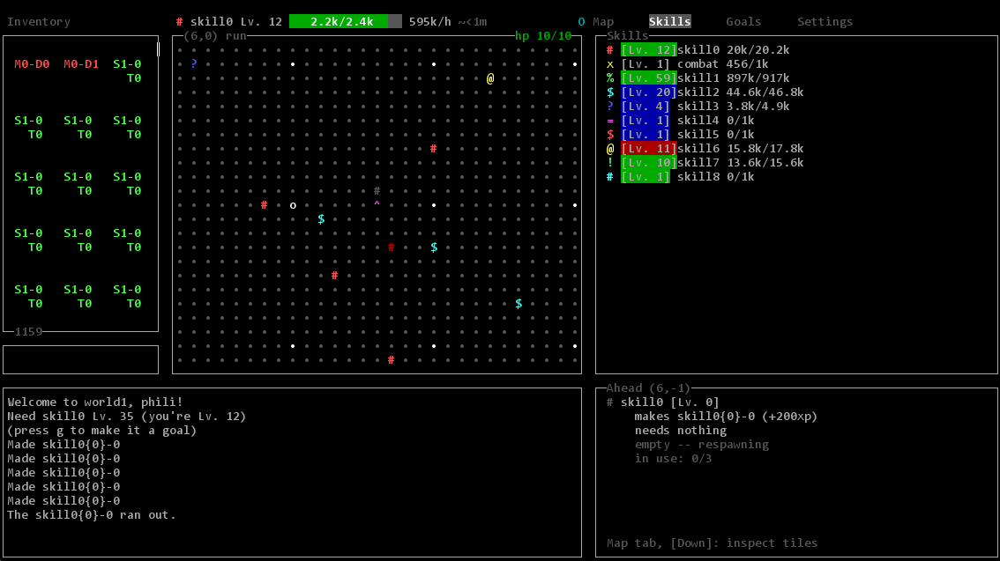
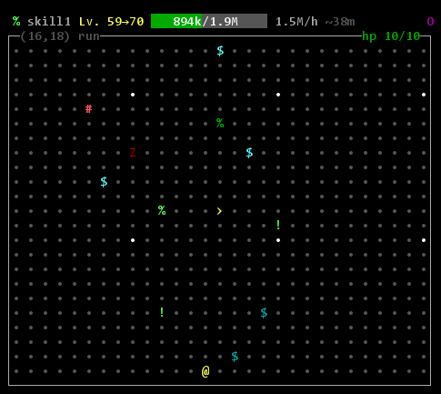
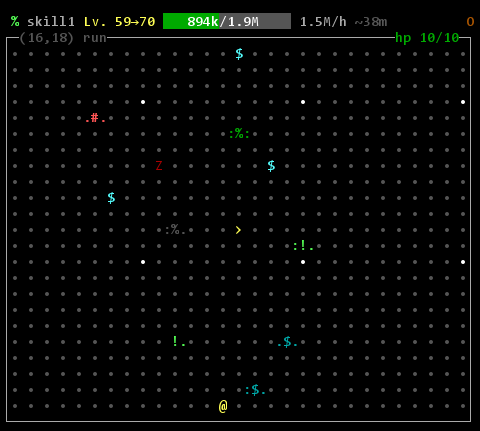

# capebabe

_(Name is subject to change)_

Java class files start with hex codes `CAFEBABE`. This is a Runescape inspired TUI multiplayer "number go up" game made in Java. 




# Playing

## Download

Get the file for your computer from the [latest release](https://github.com/philipmstc/capebabe/releases/latest).
Java comes inside, nothing else to install. Everyone who plays together needs the **same version**: the game
checks when you log in and tells you to update if not.

- **Windows:** `capebabe-<version>-windows-x64.zip`. Unzip it anywhere and double-click `capebabe\capebabe.exe`.
  Windows may say it "protected your PC" (the app isn't signed): **More info** > **Run anyway**.
- **macOS (Apple Silicon: M1 and later):** `...-macos-arm64.dmg`. Open it and drag
  capebabe into Applications. The app isn't signed, so the first time macOS refuses to open it: go to **System
  Settings > Privacy & Security** and click **Open Anyway** (on older macOS, right-click the app > **Open**).
- **Anything else** (Intel Macs, Linux): `capebabe-<version>-all.jar` with Java 17+: `java -jar capebabe-<version>-all.jar`.

## Logging in

The game opens on a few short pages:

1. **Name** and **Password**, then **Login**. The first time you use a name on a host, that password becomes
   yours there.
2. **Join a world:** **Play locally** plays your own world on your computer, straight away. **Connect to server**
   goes on to page 3. **Switch User** goes back to page one.
3. **Connect to a server:** **Host** is the host's address, e.g. `203.0.113.7` (or `203.0.113.7:43594` if they
   use another port). **World Password** is the one the host gave you. **Continue** joins; **Back** goes back to
   page 2. The game remembers the last host and name.

A wrong name or password sends you back to page one; a wrong world password, or a host that can't be reached,
keeps you on page 3.

The connection is encrypted. The server's fingerprint is on the bottom line of the login screen; the first
time you join a host it also says "first visit": check the fingerprint matches the one at the bottom of the
host's login screen. Your game remembers it, and refuses to connect if it ever changes. One connection per
address at a time, so two people in one house need the host to add `--max-per-ip 2`.

In game, press `,` for settings and the list of controls. `i` and `1`-`4` jump to the inventory and tabs, `v` to
the map, Esc goes back. Press `/` to chat with everyone in the world (`//` for debug commands).
Your progress is saved on the host's machine (in `~/.capebabe`), so you keep it as long as you join the same host
and world.

## Hosting a world for friends

Hosting is still a command (you play in the same window):

```bash
capebabe --host --world "Gabe's World" --world-password "something long"
```

where `capebabe` is `capebabe\capebabe.exe` on Windows, `/Applications/capebabe.app/Contents/MacOS/capebabe` on
macOS, `capebabe/bin/capebabe` on Linux, or `java -jar capebabe-<version>-all.jar`. `--world` picks which world
to host, by name or number; each one is its own save, and players are welcomed by its name. The default port is
`43594` (`--port` to change it). Give the world password to friends privately. To be reachable from outside your
home you'll need to forward that port; see [HOSTING.md](HOSTING.md) for the checklist and safer alternatives.

A few more hosting options: `--admins name1,name2` lets just those players use admin commands, `--bind address`
listens on one address only, and backups of the accounts and the world go to `<data>/backups` at start and every
24 hours (`--backup-hours`, `--keep-backups`). For an always-on server there's a ready-made setup in `deploy/`
(see HOSTING.md, Phase 2). Players can pick their font with `--font "Font Name"`.

## Building from source

Use `git clone` (a GitHub zip download loses `gradlew`'s permission to run on macOS/Linux), then:

```bash
./gradlew shadowJar      # build/libs/capebabe-<version>-all.jar, needs Java 17+
./gradlew packageApp     # build/dist/: the app for the OS you're on, Java included (needs a full JDK 17+)
```

On Windows without a bash shell, use `gradlew.bat`. To publish a release for every OS, bump `version` in
`build.gradle.kts`, then push a matching tag (`git tag capebabe-v0.0.2 && git push origin capebabe-v0.0.2`): GitHub Actions
(`.github/workflows/release.yml`) builds Windows and macOS (Apple Silicon) and attaches them, with the jar, to a release.

# Change log

## 0.0.3 - Oct 22 2026

- Log in now more obvious for local connections
- Log out no longer happens immediately on pressing escape from no selected menu, now has a button and a popup confirmation
- XP progress bar made huge
- player name/ total level showing in top corner
- added proper chat functionality
- added Stats tab showing more numbers going up
- map hover movement now shows intended position in red after enter
- goals can now be editted
- more player colour choices
- various UI cleanup / prettifying

## 0.0.2 - Oct 21 2026

- added github actions for stable releases, several multiplayer cleanups.


## 0.0.1 - Oct 19 2026

- Added togglable configuration to show product tiers as unique graphics 

Example without setting:



Example with setting:

